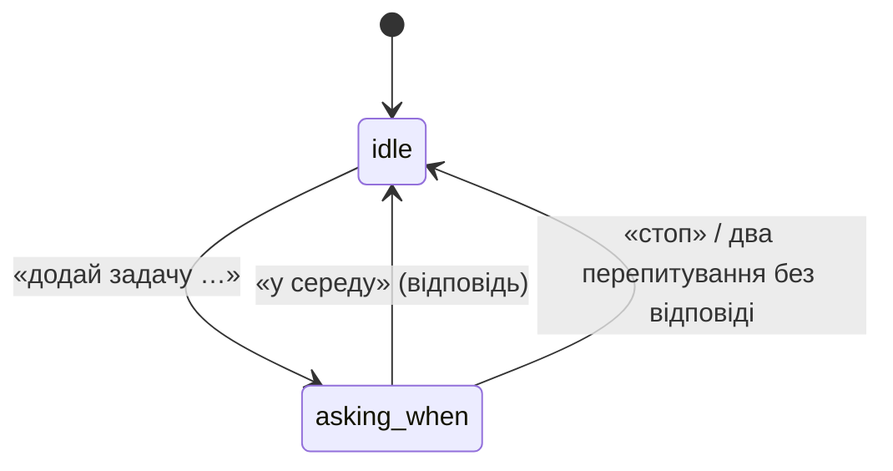

# The conversation model (`.engine/architecture/conversation-model.md` + `.json`)

Read on demand: by `/master-architect` M3 for a conversational product, by `/feature-architect` and `/plan-slice`
when a feature or a slice adds a state, an intent or a question, and by the critics' `conversation` lens. The
mechanics: `python3 .claude/hooks/conversation.py` (`check`, `gen`, `complaint`, `run`). Research:
`docs/research/2026-11-userflow/R5-conversation-state.md` (board 209).

## When it is required

When the product talks: the goals or the journeys name a voice, a chat or an assistant
(`.engine/journeys/INDEX.md` says `Інтерфейс: розмова` or `екрани і розмова`), or the code has an LLM
router (a call that turns a phrase into an intent). Not for a product with screens only.

## Why

mamamemory's conversation was a state machine nobody had written down. «Скільки часу це займе?» stayed on the
screen and took «які в нас плани на сьогодні?» as its answer; three kinds of question each decided in their own
way whether a phrase answered them; every patch to the one LLM router («ну не знаю» — other) moved other phrases.
Practice (Rasa CALM, Alexa Dialog Management, StateFlow) splits the work: **the LLM understands** — a phrase
becomes an intent from the set allowed in this state — **the machine decides** what happens: transitions,
the pending question, re-asks, cancelling.

## The rules the model must satisfy (`check` verifies each)

1. **One priority rule**, one paragraph. The engine's default, from the research: a pending question takes only a
   phrase that looks like an answer of its kind; anything else is a new command — a new frame on top, the
   question is not «caught» by the phrase; after the new command, one explicit «Повернемось до …?» or a silent
   cancel (`on_exit`), never an endless wait; an ambiguity is re-asked with two options.
2. **One routing point** — the one `path:symbol` every phrase passes. Two places that decide what a phrase means
   are two models.
3. **At most one active question per state.** The rest wait in a list («Ще 2 питання чекають»), not as `reply_to`.
4. **Every pending question** has: what is an answer (`answer_kinds`, `answer_examples`), `not_answer:
   "new_command"`, `max_retries` ≤ 2 (re-ask briefly, then with an example, then exit — Google's conversation
   design), `on_exit` (`cancel`, `resume` or `ask_resume`), `answered_to` (the state after the answer). A pending
   question without these is a dead end.
5. **A state with a pending question allows every intent the root allows.** Narrowing the router's enum under a
   question is what makes it swallow or refuse a phrase of another journey.
6. **Every intent** has 3+ example phrases and `confused_with` — the intents it is confused with, i.e. whose
   phrases it may steal. A new intent without neighbours is not ready.
7. **No invented threshold.** A time-to-live, a count beyond the engine's ≤ 2 re-asks: a goals line
   (`"source": "G3"`) or `[owner decision needed]`. The number is the owner's.
8. **Agreement with the journeys.** Every pending question of `.engine/journeys/interference.md` (its «У стані»,
   `J-N S-k`) is a pending question of the model (`"journey": "J-N S-k"`).
9. **Agreement with the code** (the Stop gate): the router's intent enum (`CONVERSATION_INTENTS="path:NAME"` in
   `.claude/project.env`) and the kinds of `reply_to` (`CONVERSATION_REPLY_KINDS="path:NAME"`) are exactly the
   model's sets. Once the routing point's file exists, `CONVERSATION_INTENTS` must be set.

What the mechanics cannot see — a must-be the category expects («що в мене сьогодні?», «стоп», «повтори»,
«допоможи», «скасуй») left out of scope, a confused pair nobody named, a priority rule that contradicts a journey —
is the `conversation` lens of `master-critic` and `feature-critic`.

## The golden corpus and the owner's complaints

`conversation.py gen` writes `tests/conversations/corpus.json` from the model: in every state, each example of
each allowed intent → that intent; under every pending question, each answer example → answered, and each
example of every other intent → that intent and **not** answered. Expectations are structural (the intent,
whether the question was answered), never the text.

**Every complaint of the owner goes into the corpus forever, with the state it was said in**:
`conversation.py complaint --state <state> --phrase "<what was said>" --expect <intent | answer> --said
"<the owner's words, verbatim>" --when "<date, place>" [--observed "<what the product did>"]`, then `gen`. A state
or an intent the model lacks is refused: the model changes first (and so do the journeys, if a step is missing).
A complaint is never removed; `check` refuses a model that drops a state or an intent a complaint names.

`conversation.py run [--k 3]` gives the corpus to the product's adapter (`CONVERSATION_RUNNER` in
`.claude/project.env`): a command that reads a JSON list `[{id, state, phrase}]` on stdin, puts the product in the
state, sends the phrase through the real routing point, and prints `[{id, intent, pending}]` (`pending`:
`answered` / `not_answered`). Green only when all k runs agree (pass^k). With the real model it costs money: run
it on a change of the router or the states and before a deploy; a red owner case blocks the deploy. The pass
rate the deploy needs for generated cases is the owner's decision (`[owner decision needed]`; the engine
proposes 100% for the owner's cases).

The `slice-tester` (mode `block`) gets the JSON as part of the contract and writes the tests of the transitions
the slice adds, without the code.

---

## Template: `conversation-model.md` (for the owner)

~~~markdown
# Модель розмови — <проєкт>
Версія: 1
Точка маршрутизації: `src/app/assistant.py:route` — кожна фраза проходить лише тут.

## Правило пріоритету
Питання, що висить, приймає лише фразу, схожу на відповідь свого виду. Будь-яка інша фраза — нова команда: її
виконуємо, а питання або питаємо знову одним реченням («Повернемось до …?»), або тихо знімаємо. Двозначно —
перепитуємо з двома варіантами, не більше двох разів, потім виходимо.

## Схема


## Стани
| Стан | Що бачить людина | Дозволені наміри | Питання |
|---|---|---|---|
| idle | кнопка «Говорити» | schedule, new_task, help, stop | — |
| asking_when | «Записала. На коли?» | schedule, new_task, help, stop | when_for_task |

## Питання, що висять
| Питання | Відповідь — це | Не відповідь | Перепитувань | Вихід | Скільки живе |
|---|---|---|---|---|---|
| when_for_task (J-2 S2) | день, час («у середу») | нова команда | 2 | спитати «Повернемось до …?» | [рішення власника потрібне] |

## Наміри
| Намір | Що це | Фрази | Плутається з |
|---|---|---|---|
| schedule | що вже заплановано | «що в мене сьогодні?», «які плани на тиждень?», «що завтра?» | new_task |
~~~

## Template: `conversation-model.json` (what `check` and `gen` read)

```json
{
  "version": 1,
  "routing_point": "src/app/assistant.py:route",
  "priority_rule": "A pending question takes only a phrase that looks like an answer of its kind; anything else is a new command, and the question is asked again once or dropped. An ambiguity is re-asked with two options, at most twice.",
  "states": [
    {"id": "idle", "root": true, "shows": "the button «Говорити»", "allowed": ["schedule", "new_task", "help", "stop"]},
    {"id": "asking_when", "shows": "«Записала. На коли?»", "allowed": ["schedule", "new_task", "help", "stop"], "pending": "when_for_task"}
  ],
  "pending": [
    {"id": "when_for_task", "reply_to": "when", "journey": "J-2 S2", "question": "Записала. На коли?",
     "answer_kinds": ["day", "time"], "answer_examples": ["у середу", "завтра о десятій"],
     "not_answer": "new_command", "max_retries": 2, "on_exit": "ask_resume",
     "ttl": "[owner decision needed]", "answered_to": "idle"}
  ],
  "intents": [
    {"id": "schedule", "says": "what is already planned", "examples": ["що в мене сьогодні?", "які плани на тиждень?", "що в мене завтра?"], "confused_with": ["new_task"]},
    {"id": "new_task", "says": "a task to put into the calendar", "examples": ["додай задачу подзвонити нотаріусу", "треба ще в аптеку", "запиши перукаря на п'ятницю"], "confused_with": ["schedule"]},
    {"id": "help", "says": "what the assistant can do", "examples": ["що ти вмієш?", "допоможи", "як з тобою працювати?"], "confused_with": ["schedule"]},
    {"id": "stop", "says": "leave what is going on", "examples": ["стоп", "досить", "скасуй"], "confused_with": ["new_task"]}
  ],
  "transitions": [
    {"from": "idle", "intent": "new_task", "to": "asking_when"},
    {"from": "asking_when", "intent": "stop", "to": "idle"},
    {"from": "asking_when", "intent": "new_task", "to": "asking_when"}
  ]
}
```

Field by field: `states[].pending` — one id or nothing (a list is the «two active questions» defect);
`pending[].reply_to` — the kind of `reply_to` the code uses for it (default: the id); `journey` — its `J-N S-k`;
`ttl` — `[owner decision needed]`, nothing, or `{"value": "…", "source": "G3"}`; `answered_to` — the state after
an answer. Every state is reachable from the root through `transitions` or an `answered_to`.

## A change of the model (`/feature-architect`, `/plan-slice`)

A feature that adds a state, an intent or a question changes the model **first** — the diff goes into the
feature file and the slice contract's «Conversation delta» — and only then the code. A new intent names its
neighbours and the phrases it may steal from them; `gen` then adds their contrast cases. `check` passes before
the critic is asked.
