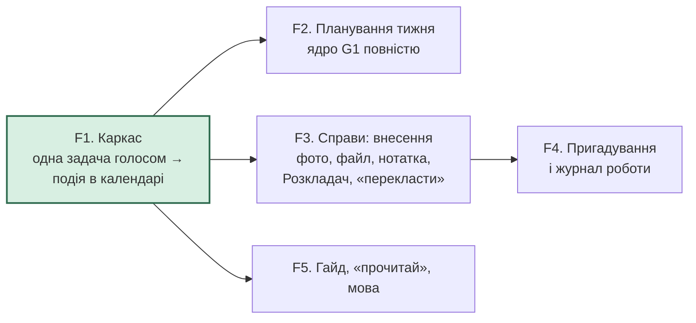

# Фічі mamamemory і порядок збирання (M4)

Статус: M4 затверджено власником («М4 затверджую.», 2026-11-05) разом зі зміною до M2 — «Так, модель по-любому Gemini.» (власник, 2026-11-05). Будується в межах затверджених M1, M2, M3
(`domain-map.md`, `architecture-map.md`). Кожну фічу далі веде `/feature-architect`, з одним раундом
власника на початку (рамка фічі).

## Граф фіч

Порядок після каркаса: F2 (ядро), F3, F5, F4. F4 чекає на F3 через G2; журнал роботи (G4) сам від F3 не
залежить, але йде разом із G2, щоб не дробити фічу.

Каркас (F1) виділено: це найтонший ланцюжок від телефона до календаря через усі шари шляху планування
(застосунок, вхід, маршрутизація, планування, Gemini, Calendar, Firestore, розгортання). Поза каркасом
лишаються Cloud Storage, модуль `cases`, Google Tasks і озвучення — їх приносять F2, F3, F5.

## Фічі

| Фіча | Що мама може робити, коли вона готова | Модулі M3 | Цілі |
|---|---|---|---|
| **F1. Каркас** (walking skeleton) | встановити застосунок, увійти своїм Google, сказати голосом одну задачу з часом, побачити текст (C9), отримати пропозицію часу й після «так» побачити подію у своєму Google Calendar; після перевідкриття застосунку побачити свій незакритий план | web, http, access, assistant (маршрутизація, «незакриті питання»), planning (одна задача: розбір, розстановка, справжній перехід `plan.py` разом з обірваним записом; якщо мама не назвала тривалості — одне питання про неї; межі часу приходять у F2, тож у F1 пропозиція може випасти на ніч — рішення архітектора, прийнято до F2), integrations (Gemini, Calendar, Firestore, google_auth), config | G1 (тонко), C1, C3, C4, C5, C7, C8 (значки), C9 |
| **F2. Планування тижня** | спланувати тиждень: кілька задач, з часом і без, Google Tasks, короткі питання про важливість, тривалість і межі часу, правки голосом, один план і одне «так», запис без дублів, обірваний запис | planning, assistant, integrations (Calendar, Tasks) | G1 (ядро) |
| **F3. Справи: внесення** | додати фото, файл чи нотатку; система кладе в справу, питає перед новою, каже, куди поклала; «перекласти»; незакрите «створити справу?» повертається після перевідкриття | web («+», фото, вибір файлу), http (маршрут завантаження), cases, assistant, integrations (Gemini, Cloud Storage) | G3 |
| **F4. Пригадування й журнал роботи** | спитати про справу й отримати її контекст; сказати «працюю над…» і потім перепитати | cases, assistant | G2, G4 |
| **F5. Гайд, «прочитай», мова** | побачити короткий гайд; почути відповідь на прохання; вибрати мову | assistant, access, integrations (Gemini-TTS), web; гайд показується на першому відкритті після розгортання F5 — за позначкою «гайд показано» під акаунтом, а не за «першим входом», який мама пройде ще в F1 | G5, C4, C8 |

**F1 будує наскрізне один раз**, щоб жодна наступна фіча його не винаходила: одна перевірка входу й
список дозволених акаунтів; одна обробка помилок; журнали в stdout; тест регіонів (C1); тести імпортів
(`placement.py` — лише стандартна бібліотека, `fastapi` — лише в `http`); таймаут кожного виклику й
дедлайн ланцюжка; `reply_to` на повідомленнях; функцію «незакриті питання» з маршрутом відкриття
застосунку, відновленням `reply_to` після перевідкриття й тестами `node --test` — першим її джерелом є
чернетка плану; `Cache-Control: no-cache` і маніфест. Запис плану в F1 іде через справжній перехід
`plan.py` («показано → записується → записано», відбиток, одна транзакція), тонко — для однієї задачі,
щоб каркас міряв той код, що лишиться. F2 і F3 додають до «незакритих питань» лише пункти свого модуля
(F3 — кожне «створити справу?» окремо для матеріалу).

## Зміна до M2 (на затвердження власника разом із M4)

Затверджена M2 (`architecture-map.md`, «PoC», пункт 5, і «Скільки справ») доручала каркасу ще перевірки
справ і фото: `gs://` з бакета, опис справи одним викликом після «перекласти», пару моделей (фото —
Flash-Lite, опис — 3.8 Flash), закриття застосунку посеред надсилання фото, P-CASES і питання на
зведення (P-CTX). M4 переносить їх у **перший slice F3** (і питання на зведення — у F4). Чому: кожен запасний
варіант для цих перевірок лежить усередині `cases`, `integrations/files` чи `config` (вбудоване фото до 7 MB, інша
модель у налаштуваннях) і не чіпає коду, який будують F1 і F2; каркас лишається найтоншим ланцюжком.
Після затвердження M4 оновлюються відповідні рядки `premise-log.md` (P-CASES, P-CTX, P-DISCONNECT) і
`architecture-map.md`.

## Що перевіряє яка фіча

**Каркас (F1)** — перше розгортання (робить Сонько). На ньому перевіряються premises, ризик яких власник
прийняв до каркаса:
- **P-AUTH** — вхід Google у тестовому режимі на справжній адресі `*.run.app`; дозволи на Calendar і Tasks
  видаються (вхід F1 одразу просить обидва — один рядок у `config`, викликів Tasks у F1 немає, тож F2 не
  міняє вхід і мамі не треба давати дозвіл удруге);
- **P-COLD** — час першої відповіді після сну, сервер на Python з бібліотеками Google; F1 міряє зі своїми
  імпортами (без Cloud Storage і озвучення), тож P-COLD міряється ще раз на розгортанні останньої фічі;
- **P-STT-UK** — справжній мамин голос з телефона (`audio/webm`), через Gemini; модель — Gemini в
  будь-якому разі, порівняння з Chirp 3 не робимо — «Так, модель по-любому Gemini.» (власник, 2026-11-05); числа показуються власникові;
- **P-PARSE** — розбір однієї задачі з мовлення на Flash-Lite;
- **P-DISCONNECT** — закрити застосунок посеред запису плану (обірваний запис повертає план у «показано» —
  гілка (5) `plan.py` будується вже в F1, тонко, для однієї задачі).

**F2** — P-PARSE для відповідей на короткі питання кроку 2 і правок кроку 3.
**F3, перший slice** — P-CASES (Розкладач на більшому вигаданому наборі справ); `gs://`; закриття
застосунку посеред надсилання фото (P-DISCONNECT, частина фото); опис справи одним викликом
після «перекласти»; змішана пара моделей (фото — Flash-Lite, опис — 3.8 Flash).
**F4** — питання на зведення («що вже з'ясували, що зробили…») і вибір справи з маминого питання (P-CTX).

Виміряні числа (час очікування, якість розпізнавання) показуються власникові; порогів немає (Q2).

## Рішення архітектора для рамок фіч (двобічні двері, власникові — як інформація)
- F3: коли мама сказала «не треба» на «створити справу?», матеріал лишається без справи, не видаляється
  (видалення ніхто не просив, і його не повернеш).
- F2: короткі питання — лише там, де без них не обійтись; тривалість і межі часу спершу беруться зі
  значень за замовчуванням (типова тривалість, денне вікно) і з минулого планування (мамі «дорого в фокусі»).
- F1: функція «незакриті питання» в F1 обслуговує лише чернетку плану; пункти справ додає F3.

## Звірка з цілями
- служить: G1, G2, G3, G4, G5, C1, C2, C3, C6, C4, C5, C7, C8, C9, D1 (кожна з G1–G5 покрита фічею; G2 і G4 — спільною F4)
- вибір між варіантами розв'язав: принципи не розрізняють порядку фіч; каркас першим — Art. 1 (premises, ризик яких прийнято до каркаса)
- не-цілі й обмеження: N1–N7 — фіч для них немає; C1 — усі фічі йдуть через integrations з регіонами з config
