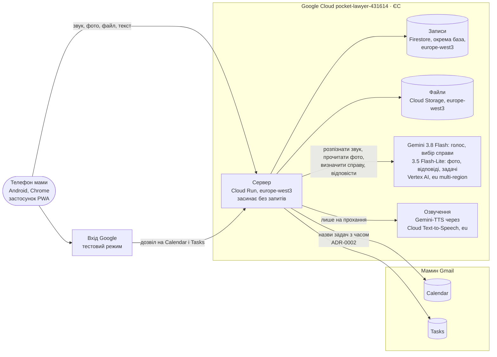
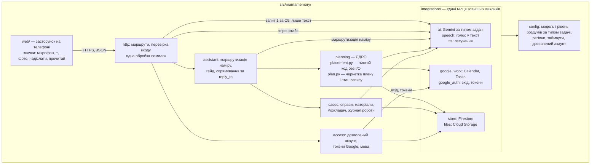

# Карта архітектури — mamamemory

## M2 — загальна будова системи (system design)

Статус: M2 затверджено власником 2026-11-05 («Так, значить, мова сервера Python. M2 і M3 затверджую.») (рішення власника всередині M2 — ADR-0003, ADR-0004, ADR-0005; цілі
v3). Час очікування мами — за Q2 без порогу; виміряний на каркасі показується власникові. Будується в межах затвердженої M1 (`.engine/architecture/domain-map.md`). Факти про
сервіси Google — `.engine/premises/premise-log.md`.

### Схема

### Як це працює, простими словами
- **Застосунок на телефоні** — веб-сторінка, яку мама встановлює з Chrome, як звичайну програму (C5).
  Він записує голос, знімає фото, додає файл, показує відповіді. Сам нічого не розуміє — усе робить сервер.
- **Сервер** — одна програма в Google Cloud у Франкфурті. Коли мамі нічого не треба, вона засинає і
  не коштує нічого; перше звернення після сну її будить, і перша відповідь приходить на кілька секунд
  пізніше (P1; скільки саме — виміряє PoC).
- **Голос у текст** — окремий крок за одним інтерфейсом, щоб сервіс можна було замінити: зараз Gemini,
  запасний варіант Chirp 3 власник відкинув: «Так, модель по-любому Gemini.» (власник, 2026-11-05). Застосунок записує звук і відправляє на сервер; сервер віддає його Gemini, той
  повертає текст сказаного — під договором і в ЄС (C1, P-STT). Вбудоване розпізнавання Chrome не беремо:
  воно йде через споживчий сервіс Google, не під договором (P-STT). Розпізнавання — окремий крок перед
  відповіддю: M1, крок 1 працює з текстом після розпізнавання (C4); поправка C9 додає, що мама бачить цей
  текст до надсилання.
- **Фото й файли** лягають у сховище файлів; Gemini одразу читає з них текст, і текст зберігається
  разом зі справою (P-OCR). Окремого сервісу розпізнавання не треба.
- **Планування: хто що рахує.** Gemini лише розбирає мамине мовлення на задачі і її правки. Розстановку
  задач у вільний час (крок 3) рахує звичайний код сервера за зайнятістю календаря і маминими межами —
  однаково щоразу. Тому повторний розрахунок перед записом (M1, крок 4) дає той самий план, якщо календар
  не змінився, і мама не отримує зайвих питань. Повтор «так» не дублює подій: запис плану веде лише
  один процес — крок 4 починається з того, що чернетка плану в одній транзакції Firestore переходить
  «показано → записується»; друге «так» бачить «записується» чи «записано» і лише повідомляє. Кожну
  створену подію й задачу сервер одразу записує у Firestore. Що сам Google Calendar відхилить подію з
  тим самим ідентифікатором, документація не гарантує (P-CALID), тож на це не покладаємося. Події створюються з
  типовими налаштуваннями маминого календаря; власних нагадувань система не додає (N5). У Tasks іде лише
  назва задачі (ADR-0002); зв'язок «задача плану ↔ задача в Tasks» сервер тримає у Firestore.
- **Пригадування справи.** Спершу 3.8 Flash визначає справу з маминого питання за описами справ; тоді сервер бере всі тексти цієї справи разом із записами роботи, прив'язаними до неї («що зробили»), і віддає їх Gemini разом із
  питанням. Окремого «пошукового» сервісу (векторної бази) немає: у справі небагато матеріалів, і вони
  вміщаються в один запит (P-CTX — перевірить PoC). Це і є «легенький раг» у найпростішій формі (Q3).
- **Озвучення** — лише коли мама натисне «прочитай»: Gemini-TTS через європейську адресу Cloud
  Text-to-Speech (українського голосу Neural2 там немає, Gemini-TTS українською є — P-TTS).
- **Записи** (справи, тексти документів, нотатки, журнал роботи, стан розмови, чернетка плану, дозвіл
  на календар, налаштування акаунта — мова; мамині межі часу з минулого планування тримає планування) — в окремій названій базі Firestore у Франкфурті, під маминим акаунтом (ADR-0001, ADR-0004).
- **Календар і задачі** — сервер пише в мамині Google Calendar і Tasks лише назви задач із часом
  (ADR-0002); жодних технічних позначок у задачах, які мама бачить.
- **Вхід** — через Google, у тестовому режимі: мамин акаунт — тестовий користувач, раз на тиждень вона
  входить заново (ADR-0003). Список тестових користувачів спільний з Pocket_lawyer, тому сервер сам
  пропускає лише мамин акаунт за його ідентифікатором (C3, C7). Дозволи: запис подій у Calendar, читання
  зайнятості календаря, Google Tasks — точний набір перевіряє PoC 3.
- **Проєкт** — поки спільний `pocket-lawyer-431614` (ADR-0003): екран входу спільний з Pocket_lawyer.
- **Журнали сервера** — у стандартному сховищі Google, без окремих заходів (ADR-0005).
- **Розгортання** — робить Сонько (docs/infra.md); runner у хмару не ходить.

### Що розглянуто і відкинуто
| Рішення | Обрано | Відкинуто і чому |
|---|---|---|
| Скільки серверів | один сервер Cloud Run (моноліт) | окремі функції на кожну дію — «function soup», важче підтримувати; постійна віртуальна машина — платна цілодобово (P1, C6). Плейбук: «Monolith (the default)», established; «Serverless… Use when: spiky or low/intermittent traffic», contested — тут трафік саме такий |
| База записів | Firestore Native, europe-west3, окрема названа база (ADR-0004) | Postgres у Cloud SQL — «boring default» плейбука (§1, Datastore), але працює й оплачується цілодобово (C6, P1); eur3 — доступність, якої жоден рядок не вимагає; SQLite-файл у сховищі — немає безпечного блокування |
| Модель | за PoC 1–2 (poc/out/, 2026-10-24) — модель на тип задачі, лише назва в налаштуваннях. Правило вибору (рішення архітектора, записане до PoC у цій карті): береться найдешевша gemini-3.5-flash-lite (Q1), крім задач, де PoC показав явний провал — справу визначено не ту, або відповідь не з матеріалів справи. **gemini-3.8-flash** — усе, що вибирає справу з каталогу описів: розкладання нового матеріалу, потім оновлення опису справи окремим викликом (як міряв PoC 1), і визначення справи з маминого питання для G2 (Flash-Lite: c06→нова, c10→c05, c17→c14 — і це не схожі прізвища, Fischer→Meyer, Koch→Schulz, тож підозра на якість опису; нуль помилок 3.8 Flash отримано саме з описами від 3.8 Flash); і розпізнавання голосу (критерій додано після PoC, правилом він не передбачений: Flash-Lite спотворює терміни до невпізнання: «Uberzen», «TSGH4», «арцбрів», тож мама частіше записуватиме наново; одна перестановка «Майєр/Маєр» була в 3.8 Flash, а Flash-Lite почув правильно — без C9 таку помилку мама не побачить). **gemini-3.5-flash-lite** — читання фото і пошук у матеріалах уже визначеної справи (PoC: 79/79, 4/4 на питанні про одне значення); розбір задач (крок 1 ядра) і маршрутизація Асистента — Flash-Lite за Q1, **не перевірено, перевіряє каркас**. Обидві через eu multi-region. Двобічні двері | одна модель на все — 3.8 Flash коштує вдвічі більше й у PoC відповідала в ~6 разів повільніше там, де Flash-Lite справилась так само; лише Flash-Lite — помиляється у виборі справи і в термінах; gemini-3.5-flash у Франкфурті — дорожча ($1.65/$9.90), а країна понад ЄС жодним рядком не вимагається (C1); global endpoint — без гарантії, де обробляються дані (C1); консумерський Gemini API — не Cloud Service |
| Голос у текст | Gemini (звук → текст) за одним інтерфейсом | Web Speech API Chrome — споживчий сервіс (C1); Cloud Speech-to-Text Chirp 3 (eu, uk-UA GA) — під договором і в ЄС, але ще один сервіс; лишається запасним варіантом, якщо справжній мамин голос Gemini не впорається |
| Озвучення | Gemini-TTS, eu | вбудоване озвучення Chrome — де обробляється, не задокументовано (C1); Neural2 з EU-адреси — немає українського голосу |
| Проєкт Google Cloud | спільний `pocket-lawyer-431614` (ADR-0003, рішення власника) | окремий проєкт — радив архітектор (ізоляція екрана входу, ліміту користувачів, бази й доступів); власник: «Поки воно ще зарано» |
| Вхід | тестовий режим (ADR-0003, рішення власника) | робочий режим без перевірки — один раз екран «неперевірений застосунок», але перемкнув би й Pocket_lawyer; перевірка Google — політика, домен, відео, 3–10 днів |
| Пошук по справі | усі тексти справи в один запит | векторна база — ще одна частина, яку треба тримати й оплачувати; плейбук §0: проблеми ще немає |

### Таблиця елементів
| Елемент | Що робить | Джерело |
|---|---|---|
| Застосунок PWA | встановлюється з Chrome; мікрофон, камера, файли; показує розмову | C5, C4, G3 |
| Сервер Cloud Run | уся логіка: Асистент, Планування, Справи, Вхід; засинає без запитів | C2, P1, C6 |
| Firestore | записи: справи, тексти, нотатки, журнал роботи, стан розмови, чернетка плану, дозвіл на календар — під акаунтом | docs/adr/0004-firestore-native-europe-west3.md, docs/adr/0001-data-under-signed-in-account.md |
| Cloud Storage | оригінали фото й файлів | G3, C1 |
| Перевірка регіонів | автоматичний тест на налаштовані адреси сервісів (кілька рядків): Vertex і Cloud Text-to-Speech лише eu (жодного global, жодної моделі, що є лише в global), Firestore і Cloud Storage лише europe-west3 | C1 |
| Gemini на Vertex AI (EU) | голос у текст, читання фото, вибір справи, описи справ, відповіді, розбір задач, маршрутизація Асистента | G1, G2, G3, G4, C1, C4 |
| Gemini-TTS у Cloud Text-to-Speech (eu) | озвучення відповіді на прохання | C4, C1 |
| Google Calendar API, Tasks API | читання вільного часу й відкритих задач, запис плану | G1, C2, docs/adr/0002-task-titles-in-mama-calendar.md |
| Вхід Google (OAuth, тестовий режим) | вхід лише мамина акаунта і дозвіл на Calendar і Tasks | C3, C7, docs/adr/0003-shared-project-testing-oauth.md |
| Вибір мови | мова розмови під акаунтом (поки лише українська): нею асистент відповідає, питає в плануванні, розповідає гайд (G5); вона ж — мова розпізнавання й озвучення | C8 |
| Інтерфейс значками | мікрофон, «+», фото, «надіслати», а біля відповіді — «прочитай» (C4); без текстових підписів | C8, C5, C4 |
| Голос у текст до надсилання | «Надіслати» під час запису зупиняє запис і показує розпізнаний текст; друге «надіслати» відправляє | C9, C4 |

### Результати PoC 1–2 (2026-10-24, запуск Сонька, location eu, вигадані дані)
- **Фото:** значення з бланка прочитане в 79 з 79 на обох моделях (P-OCR).
- **Справи:** 3.8 Flash — без помилок на 3, 6, 12, 24 справах зі схожими прізвищами; 3.5 Flash-Lite —
  помилки з 6 справ (одна наявна справа прийнята за нову, два матеріали в чужу справу).
- **Відповіді:** правильні 4 з 4 на обох — але PoC питав лише одне значення («останній аналіз»), а справу
  отримував готовою; справа з 30 синтетичних матеріалів — ≈ 2,8 тис. токенів, один запит із великим
  запасом (P-CTX); справжній Arztbrief чи договір у рази довші за синтетичний бланк, але навіть сотня
  сторінок тексту — десятки тисяч токенів, далеко від межі контексту моделі. Питання на зведення («що вже з'ясували, що зробили») і вибір справи з питання —
  перевіряє каркас.
- **Голос:** 3.8 Flash чує німецькі терміни (HbA1c, TSH, Arztbrief, Ramipril, Überweisung), пропуски —
  переважно написання прізвищ і цифри замість слів; одна перестановка «Майєр/Маєр». Flash-Lite
  спотворює терміни. Розпізнавання 3.8 Flash — ≈ 7,6 с на коротку фразу. Озвучення — 10 з 10, ≈ 5 с.
  Перевірено лише на синтетичному голосі (той самий Gemini озвучував і розпізнавав — найлегший випадок),
  у форматі `audio/ogg`; справжній голос мами з телефона і `audio/webm` з Chrome — не перевірено; ризик
  до першого розгортання каркаса прийняв власник: «Ні, значить ми вибираємо 2, прийняти ризик.»
  (2026-10-24 17:53 UTC); запасний варіант — Chirp 3 (P-STT-UK).
- **Ціна** всього PoC 1 (257 викликів): $0.16 (Flash-Lite), $0.35 (3.8 Flash) — без токенів «роздумів»,
  які 3.8 Flash рахує за замовчуванням (MEDIUM) як вихідні; справжня ціна 3.8 Flash вища. На поділ
  моделей це не впливає (помилка на користь нинішнього поділу).
- Обмеження: синтетичні фото й синтетичний голос; справжніх маминих записів не було.
- **Скільки чекати мамі** (числа з PoC, порогу немає — Q2): голос → сон сервера (P-COLD) + ≈ 7,6 с
  розпізнавання, потім відповідь; фото → читання на Flash-Lite (≈ 1 с) + розкладання на 3.8 Flash
  (у PoC 1 ≈ 6 с на виклик у середньому) + оновлення опису справи на 3.8 Flash (≈ 6 с) — усе в одному
  запиті, бо сервер не працює після відповіді (P1: дешевше понад швидше; відкласти оновлення означало б
  платити за процесор після відповіді, або розкладати наступне фото за застарілим описом, чого не міряли,
  або чекати окремого другого запиту від застосунку — а якщо мама закриє застосунок, опис так і не
  оновиться); голосове питання про справу (G2 з C9) → запит 1: сон сервера +
  ≈ 7,6 с розпізнавання, мама перечитує; запит 2: маршрутизація (не міряно) + визначення справи на 3.8
  Flash (≈ 6 с) + відповідь (≈ 1 с).
- **Скільки справ** витримує Розкладач: без помилок до 24 справ; більше не міряли, а скільки справ буде
  в мами — невідомо (P-CASES, перевіряє перший slice F3 на більшому вигаданому наборі — зміна M4).

### PoC (Art. 1) — найризикованіше
1. **Справа з фото і відповідь із матеріалів** (P-CTX, P-OCR): зростаюча кількість справ (схожі пацієнти
   зі схожими аналізами), щоб показати, з якої кількості Розкладач починає помилятися — оцінює власник;
   нотатки й питання українською, документи німецькою; описи справ — так само, як у робочій системі; одна справа — з верхнього краю,
   пацієнт, якого ведуть місяцями («Пацієнт же ж ведеться там місяцями. Є завжди там куча контексту»,
   журнал 17:41Z). Gemini визначає справу для нового фото і відповідає на питання про справу; 3.5
   Flash-Lite і 3.8 Flash. Звіт — що вийшло, на скількох справах і матеріалах, і з якого обсягу один
   запит перестає вміщатися або помітно дорожчає (P1, C6); власникові — коротке повідомлення.
2. **Голос у текст і озвучення українською**: розпізнавання через Gemini, ті самі дві моделі (P-STT),
   українське мовлення з німецькими іменами й медичними термінами;
   озвучення через gemini-2.5-flash-tts у `eu` Cloud Text-to-Speech (P-TTS).
3. **Вхід у тестовому режимі** на справжній адресі розгортання (`*.run.app`): адреса проходить як
   дозволена, дозволи на Calendar і Tasks видаються (P-AUTH).
4. **Час першої відповіді після сну** Cloud Run (P-COLD).
5. **Перші виклики F3** (перенесено з каркаса в M4, затверджено власником): опис справи-джерела, перебудований одним викликом після «перекласти», —
   розкласти за ним новий матеріал; закрити застосунок посеред надсилання фото — чи оновився опис справи
   (P-DISCONNECT); фото до Gemini посиланням `gs://` з бакета europe-west3 через `eu`
   (запасний шлях — вбудоване фото до 7 MB); розкладання, коли текст фото дає Flash-Lite, а опис будує
   3.8 Flash (цю пару PoC 1 не міряв); G2-питання у формі власника («що вже з'ясували, що зробили…»).
6. **Справжній мамин голос** (P-STT-UK, ризик прийнято до каркаса): кілька її фраз із телефона
   (`audio/webm` з Chrome) — через 3.8 Flash і Chirp 3 поруч (для Chirp 3 явно `WEBM_OPUS`, 48000 Гц);
   результат показати власникові, вирішує він. Розбір задач і маршрутизація на Flash-Lite (P-PARSE) —
   там само.
PoC 1–2 запускає Сонько в проєкті власника на вигаданих даних (runner у хмару не ходить): скрипти
`poc/poc1_cases.py`, `poc/poc2_voice.py`. PoC 3–4 перевіряються на першому розгортанні робочого
каркаса; до того ризик прийняв власник: «yes» (2026-10-24 ~12:43 UTC) на питання «PoC 1–2 зараз через
Сонька, а PoC 3–4 — на першому розгортанні з вашим прийняттям ризику — так?».

### Конвенції для M3 і для feature-architect
- Модель — налаштування на тип задачі, пара (модель, рівень «роздумів»), не в коді; кожен виклик моделі
  належить одному з цих типів: розпізнавання голосу (3.8 Flash); вибір справи — розкладання матеріалу,
  визначення справи з питання, визначення матеріалу, який мама назвала для «перекласти» (3.8 Flash; на вході — каталог матеріалів:
  час, справа, вид, перші рядки тексту);
  запис «працюю над» зберігається одразу з часом, без окремого виклику — прив'язка до справи лише тоді,
  коли маршрутизація назвала справу і назва збігається з наявною (M1: «не окремий механізм»); оновлення опису справи (3.8 Flash, окремим викликом після розкладання —
  так, як міряв PoC 1); читання фото, відповідь з матеріалів справи, відповідь із журналу роботи без
  справи («що я робила вчора?»), розбір задач — і маминої мови кроку 1, і її відповідей на короткі
  питання кроку 2 (що важливіше, тривалість, межі часу), і її правок кроку 3 («ні, перенеси…»), маршрутизація Асистента (Flash-Lite; три останні — не
  перевірено, перевіряє каркас). Якість із PoC чинна лише для рівня роздумів, з яким міряли (типовий,
  MEDIUM); зміна рівня — повторний прогін PoC-скрипта цього типу; для розпізнавання голосу на 3.8 Flash перевірити в каркасі, чи зменшує час
  менший рівень «роздумів» моделі.
- Сервер не працює після відповіді: читання фото, визначення справи — усередині запиту (Cloud Run
  обмежує процесор після відповіді).
- Фото до Gemini — посиланням `gs://` з Cloud Storage, не вбудованим вмістом (ліміт 7 MB); пам'ятати
  про ліміт тіла запиту Cloud Run.
- Стан розмови (незавершене «створити справу?» з уже завантаженим фото, останній покладений матеріал,
  чернетка плану) — у Firestore під акаунтом, бо сервер засинає.
- Після «перекласти» описи оновлюються двома викликами 3.8 Flash: справа-адресат — одне оновлення опису з
  перекладеним матеріалом (той крок, що міряв PoC 1); справа-джерело — один виклик, що будує опис з усіх
  її текстів (справа вміщається в один запит, P-CTX); обидва описи записуються наприкінці (два виклики незалежні, тож ідуть паралельно — та сама ціна). Справа,
  в якій не лишилося матеріалів, лишається з порожнім описом (видаляти справи цілі не просять). Переграш по
  матеріалу — до ~60 викликів на парі великих справ, понад таймаут Cloud Run; якість опису з одного
  виклику перевіряє каркас (PoC 5) — так, щоб факти перекладеного матеріалу не лишалися в описі чужої справи.
- Кожен зовнішній виклик (Calendar, Tasks, Gemini, Firestore — зокрема її власні повтори транзакцій,
  Cloud Storage) має власний таймаут, і кожен ланцюжок зовнішніх викликів в одному запиті (запис плану,
  обробка фото, «перекласти») має загальний дедлайн: таймаут запиту Cloud Run мінус два найдовші
  таймаути одного виклику (запас і на останній виклик, і на транзакцію шляху помилки). Перед кожним викликом ланцюжок перевіряє дедлайн і, якщо часу нема, іде шляхом
  спійманої помилки. Так жоден ланцюжок не доходить до таймауту Cloud Run; на випадок виклику, що пережив
  власний таймаут, кожен перехід зі стану «записується» і кожен запис ідентифікатора виконується лише
  тоді, коли в чернетці досі той самий час початку запису (ціна — одне порівняння в транзакції; час
  початку вже зберігається). Таймаут запиту Cloud Run — одне значення в `config`, і Сонько ставить те саме
  значення під час розгортання (Cloud Run не передає його в контейнер).
- Автоматичні повтори — лише для читання й викликів Gemini. Створення подій і задач не повторюється
  автоматично (Calendar і Tasks не відкидають дублі, P-CALID); таймаут на створенні — той самий випадок,
  що й падіння між створенням і записом ідентифікатора.
- **Обірваний запис плану** — помилка, спіймана в тому самому запиті, або «записується», старший за час
  очікування запиту Cloud Run, — в одній транзакції повертає план у «показано». Запис кожної задачі —
  два кроки: подію створено (або задачу без часу створено в Tasks) і, якщо задача прийшла з Tasks, її
  закрито в Tasks. Задачі з обома кроками виходять зі списку на розстановку, а їхні події — звичайна
  зайнятість календаря; задача з подією, але не закрита в Tasks, закривається без нового «так» — на
  наступному запиті, що торкається чернетки, і щонайпізніше перед кроком 1 наступного планування (це
  друга половина запису, який мама вже підтвердила).
  Решту мама бачить як новий план («записано не повністю — ось решта») і пише її новим «так»; порожня
  решта веде одразу в «записано». Система ніколи не записує розстановку, якої мама не бачила, і план не застрягає (G1).
- Гайд (G5) показується текстом на найпершому вході під акаунтом, а не на кожному щотижневому повторному вході
  (ADR-0003), і потім — на «що ти вмієш?».
- «Перекласти» (G3) працює для будь-якого матеріалу, який мама назве словами, не лише для останнього
  покладеного: мама найчастіше помітить хибну справу пізніше.
- Вхід у тестовому режимі спливає раз на 7 днів (ADR-0003): планування перевіряє дозвіл на Calendar і
  Tasks до кроку 1; якщо дозвіл спливе пізніше, чернетка плану лишається у Firestore, і після входу цикл
  іде далі з того самого місця.
- Розкладач шле Gemini назви справ і короткий опис кожної (не всі тексти), разом із самим новим
  матеріалом — фото як зображення, нотатку як текст (так міряв PoC 1). Файл через «+» — PDF як PDF,
  зображення як зображення (типи, які приймає Gemini: png, jpeg, webp, heic, pdf); інші типи (.docx
  тощо) застосунок не приймає й так і каже — без вигаданих перетворень; простий текст (.txt) читається як
  текст. Word-файли (.docx) — лише як фото чи PDF (власникові сказано як інформацію).
- Запис плану починається лише на «так», що відповідає саме на показаний план (останнє поставлене
  питання або кнопка, прив'язана до цього плану), — не на «так» до «створити справу?».
- Запис плану: правило одного записувача — у розділі «Планування: хто що рахує» вище; гілки стану — у M3
  (`plan.py`). Тут лише деталі: Tasks не приймає власного ідентифікатора, тож якщо сервер впаде між
  створенням задачі й записом її ідентифікатора, повторне «так» може дати одну зайву задачу в Tasks
  (рішення архітектора: рідкісний випадок, двобічні двері). Ідентифікатор події складається з
  ідентифікаторів чернетки й задачі, закодованих у base32hex (Calendar приймає в `id` лише a–v і 0–9,
  5–1024 символи), і не змінюється між спробами; під час перерахунку сервер впізнає власні ще не записані
  події за цим ідентифікатором у відповіді `events.list` і одразу записує їх як створені — дубля події
  немає. Вже записані події цього плану — звичайна зайнятість.
- Хто може ввійти — у розділі «Вхід» вище й у M3 («Наскрізне — один раз»).

### Пропозиції
- Окремий сервісний акаунт для mamamemory з доступом лише до своєї бази, сховища і Vertex AI. Ціна:
  один акаунт і кілька ролей (робить Сонько); користь — сервіси Pocket_lawyer не читають мамині дані.
  Поза дизайном, бо власник відмовився від додаткових заходів (ADR-0005); ролі в проєкті не перевірено.
- Окремий проєкт Google Cloud для mamamemory (відкладено власником, ADR-0003). Ціна: один проєкт, той
  самий білінг; користь — свій екран входу й робочий режим без щотижневого входу, ізоляція даних.

### Звірка з цілями
- служить: G1, G2, G3, G4, G5, C4, C5, C8, C9, D1
- вибір між варіантами розв'язав: P1 (сервер, що засинає; оплата за використання), C6 і Q1 (не Cloud SQL; дешевша модель), C1 (лише EU-endpoint, не Web Speech API); рішення власника — ADR-0003, ADR-0004, ADR-0005
- не-цілі й обмеження: N2, N3, N4, N5 — не зачеплені; N6 — дані під акаунтом (ADR-0001); C1 — сервіси, що бачать дані, у Cloud під договором і в ЄС; винятки прийняв власник — назви задач (ADR-0002), журнали в стандартному сховищі (ADR-0005); C2 — усе Google; C3, C7 — вхід лише мами (ADR-0003); C6 — усе з оплатою за використання

## M3 — внутрішня будова коду (software architecture)

Статус: M3 затверджено власником 2026-11-05 («Так, значить, мова сервера Python. M2 і M3 затверджую.»); мова сервера — docs/adr/0006-server-language-python.md.

### Схема — модулі й дозволені залежності

Стрілка — «може залежати від». Залежності йдуть лише вниз; `planning` і `cases` одне від одного не
залежать; `placement.py` не імпортує нічого, крім стандартної бібліотеки (`datetime`, `zoneinfo`), — рахує
розстановку з того, що йому дали (тест на імпорти стежить за цим, кілька рядків). `config` — кінцевий
модуль: від нього може залежати кожен, сам він ні від чого не залежить.

### Шляхи кожного запиту й кожного виклику моделі (з M2)
| Що | Шлях |
|---|---|
| Запит 1 за C9: голос → текст на екран | `http → ai.speech` (мова з `access`, передається параметром); нічого не зберігається |
| Запит 2: надісланий текст + `reply_to` | `http → assistant` (маршрутизація через `ai`, Flash-Lite, з модулем і питанням із `reply_to`) → `planning` або `cases` |
| Натиснута кнопка з `reply_to` | `http → assistant → planning` або `cases` напряму, без виклику маршрутизації (дешевше, і «так» на план не залежить від неперевіреного P-PARSE) |
| «Прочитай» біля будь-якої відповіді, гайд | `http → ai.tts` (мова з `access`); гайд показується текстом і звучить лише на «прочитай» (C4: голосом — «по запиту, а не кожен раз») |
| Розбір задач (крок 1), розстановка (крок 3), запис (крок 4) | `assistant → planning → ai` / `placement.py` / `google_work`, `store` |
| Фото чи файл через «+» | `http → assistant → cases → files, ai` (читання фото — Flash-Lite; розкладання й оновлення опису — 3.8 Flash), `store` |
| Питання про справу, «що я робила?», «перекласти» | `assistant → cases → ai, store` |
| Запис «працюю над» | `assistant → cases → store` (без окремого виклику моделі) |
| Вхід, мова, токени Google | `http → access → store` |
| Відкриття застосунку | `http → assistant` (функція «незакриті питання») `→ planning, cases`: показується лише найновіше незакрите питання зі своїм `reply_to` і рядок «ще N питань чекають» — решта по одному на прохання (мамі «дорого в фокусі»); план при сплилому вході — «увійди знову», решта — завжди; на найпершому вході — ще й гайд (G5). Не сповіщення: лише коли мама сама відкрила застосунок (N5) |

### Як це працює, простими словами
- **Мова й каркас.** Сервер — Python 3.12 і FastAPI; застосунок — проста веб-сторінка (HTML і
  JavaScript без збирання) у `src/mamamemory/web/`, яку сервер віддає сам. Python — бо PoC уже
  працював саме з цими бібліотеками Google через `eu`, у Google є офіційні Python-бібліотеки для
  Calendar і Tasks, а типовий ланцюжок перевірок движка (`gate.py`: ruff і mypy — з налаштувань у
  `pyproject.toml`, pytest; `.claude/project.env`: `src`, `.py`) працює для Python без налаштувань.
  Застосунок лежить під `src/`, щоб і його зміни бачив overseer. Логіка застосунку, яку варто тестувати,
  — стан C9 (запис → текст на екрані → «надіслати») і `reply_to` — окремий чистий модуль JavaScript з
  тестами `node --test` (Node v24 уже на машині, пакетів не потребує). Stop-гейт движка їх не запускає
  (він перевіряє лише `.py` і pytest), тож ці тести проганяє будівник сам; щоб overseer зарахував
  `node --test` як перевірку, у `.claude/project.env` стоїть `CHECK_CMDS="pytest ruff mypy node"`. Решту
  сторінки перевіряє прогін каркаса.
- **Без service worker.** Встановити застосунок з меню Chrome на Android можна й без нього (з Chrome
  108); власник встановлює його разом із мамою (N7). Без service worker немає й ризику, що застрягне
  стара версія сторінки. Сторінку й файли JavaScript сервер віддає із заголовком `Cache-Control: no-cache`,
  щоб після розгортання браузер не тримав стару сторінку з новим сервером. Для встановлення з меню
  потрібен маніфест: назва, значки 192 і 512 px, `start_url`,
  `display: standalone`, HTTPS.
- **Папки за тим, що робить система** (playbook §5.1, §5.2): `planning`, `cases`, `assistant`, `access` —
  ті самі частини, що в M1.
- **Ядро планування** — дві речі. `placement.py`: на вході події календаря, задачі з порядком, тривалістю й обмеженнями (названа мамою
  дата чи час, обмеження з її правок — «у четвер», «не раніше…»; зберігаються в `plan.py` структуровано,
  щоб перерахунок на «так» не викликав Gemini), мамині межі часу (місцеві години), часовий пояс маминого
  календаря, теперішній час, горизонт (кінець — абсолютна дата, збережена в чернетці, а не «зараз + тиждень»,
  інакше перерахунок на «так» зсуває горизонт) — бо сервер працює в UTC, а межі й літній/зимовий час — німецькі; під час показу
  найраніший початок — строго після «зараз», округлений угору до кроку розстановки з `config` — 15 хвилин
  (рішення архітектора, двобічні двері; власникові сказано як інформацію); на «так» — max(T0, «зараз»), де T0 — найраніший початок показаного плану,
  збережений у чернетці; так план не зсувається від пауз між показом і «так» (чистий тест: «так» через N
  секунд після показу дає той самий відбиток); на виході — задачі на час, задачі
  без часу, «не вмістилось»; однаково щоразу, тести без жодного сервісу. `plan.py`: документ чернетки
  плану — входи (задачі, порядок, межі часу, правки), яке коротке питання кроку 2 наступне, **відбиток
  показаної розстановки** (хеш від «задача, початок, кінець» і переліку «не вмістилось» — лише для
  порівняння, ніколи не для запису: сама розстановка, як і в M1, не зберігається), стан запису
  (показано → записується → записано, з часом початку), ідентифікатори записаних подій і задач.
  На «так»: (1) поза транзакцією перерахувати розстановку за теперішнім календарем і порівняти відбиток;
  (2) транзакція «показано → записується» проходить, лише якщо стан «показано» і відбиток той самий, на
  який мама відповіла; (3) стан «показано», але відбиток інший — показати новий план, порахований за
  правилом показу (строго після «зараз», з кроком розстановки), записати його T0 і відбиток, стан
  лишається «показано»; (4) стан «записано» або свіжий «записується» — лише повідомити
  («план уже записано» / «записую»); (5) обірваний запис — назад у «показано» з рештою (див. M2).
  Кожна гілка вирішується чистою функцією `plan.py` всередині однієї транзакції, що читає стан, — тож
  гілка (3) не перезапише щойно поставлене паралельним «так» «записується». Виклики Calendar у транзакцію
  не входять (вона може повторитися). «Так» — кнопкою чи
  голосом — несе відбиток плану з `reply_to`. Мамині
  межі часу з минулого планування — теж тут, і лише тут («як минулого разу?»).
- **На яке питання відповідає мама (`reply_to`).** Кожна відповідь асистента несе питання, яке вона
  ставить, — вид, ідентифікатор, для плану ще й відбиток саме цього плану — або «немає». Застосунок
  прив'язує це значення до самого повідомлення на екрані:
  - **кнопка** («так» під планом, «так» під «створити справу?») несе `reply_to` **свого** повідомлення —
    кнопка під старішим планом шле відбиток старішого плану, і сервер покаже план наново, а не запише
    новіший;
  - **текст і голос** несуть `reply_to` останньої відповіді асистента, що є на екрані; після
    перевідкриття застосунку — `reply_to` показаного незакритого питання (показується лише найновіше, решта
    — по одному на прохання), а якщо незакритих питань немає —
    «немає» (значення живе лише разом з повідомленням, без окремого збереження);
  - розпізнаний текст (запит 1), звук «прочитай» і повідомлення про помилку `reply_to` не змінюють.

  Асистент спрямовує «так» чи «ні, перенеси…» лише до модуля й питання з `reply_to`. **Незакриті питання**
  — одна функція в `assistant` для двох випадків: відкриття застосунку і випадок, коли маршрутизація
  визначила відповідь («так» чи «ні»), а `reply_to` — «немає» (тоді асистент не питає «на що саме так?», а
  показує їх; звичайне питання на кшталт «що я робила вчора?» з `reply_to` «немає» дістає звичайну відповідь). Вона питає кожен модуль окремо: `cases` — кожне «створити
  справу?» (без Google, повертається завжди); `planning` — чернетку плану (єдиний пункт, що потребує
  облікових даних Google: перерахунок показаного плану за M1 і закриття в Tasks; коли вхід сплив — лише
  цей пункт стає «щоб показати план, увійди знову»; чернетка на кроці 2 — наступне коротке питання — Google
  не потребує й показується завжди); на найпершому вході — ще й гайд (G5). Помилка одного пункту не
  забирає інших (тест модуля з підставним Google, у якого сплив вхід: «створити справу?» повертаються).
  **Як питання закривається без «так»:** «ні» на «створити справу?» — асистент питає, у яку справу
  покласти, і питання лишається відкритим до відповіді; «не треба» закриває його (G3: «Вона собі рішить,
  що вона куди заносить»; чи матеріал тоді лишається без справи, чи видаляється — питання власникові у
  frame фічі справ); нове планування замінює стару чернетку; чернетка,
  горизонт якої минув, закривається сама й більше не показується. Асистент не тримає, на яке
  питання чекає відповідь; незакриті питання тримають модулі у Firestore (M2) і перевіряють, що `reply_to`
  ще чинне; «створити справу?» тримається окремо для кожного матеріалу (список), щоб друге фото не
  перезаписало перше. Після перезавантаження сторінки незакриті питання повертаються самі. Тести `node --test`: кнопка під старішим планом після новішого питання шле свій
  `reply_to`; запит 1 не скидає `reply_to`; після перезавантаження незакрите питання повертається зі
  своїм `reply_to`.
- **Усі зовнішні виклики — в `integrations`.** Gemini (зокрема голос у текст і озвучення), Calendar,
  Tasks, Firestore, Cloud Storage, а також обмін коду входу Google на токени й оновлення токена
  (`integrations/google_auth`) — один модуль на сервіс, з таймаутами й регіонами з `config`. Модель і
  рівень роздумів для кожного типу задачі — у `config` (M2). Голос у текст — одна функція в `speech`;
  запасний Chirp 3 (P-STT-UK) замінює лише її.
- **Наскрізне — один раз** (playbook §6.1):
  - вхід: Google OAuth на сервері (він і так потрібен, щоб отримати дозвіл на Calendar і Tasks), після
    нього — підписане cookie сесії; секрет для підпису й секрет клієнта OAuth — у Secret Manager, Cloud Run
    передає їх змінними середовища (крок розгортання для Сонька; бібліотека Secret Manager у коді не
    потрібна);
    одна перевірка на всі маршрути: cookie чинне і акаунт — у списку дозволених у `config`;
  - кожна функція `store` і `files` отримує ідентифікатор акаунта з цієї перевірки (ADR-0001); мамин
    ідентифікатор живе лише в списку дозволених у `config`, ніде в коді;
  - помилки — одна обробка, що повертає мамі зрозуміле повідомлення;
  - журнали — стандартний logging у stdout (ADR-0005);
  - фонових задач немає: ні `BackgroundTasks` FastAPI, ні потоків — Cloud Run після відповіді обмежує
    процесор, тож усе завершується до відповіді (M2);
  - час — через параметр, щоб тести не залежали від годинника.
- **Що передається параметрами з `http`.** Ідентифікатор акаунта; спосіб отримати мамині облікові дані
  Google (`http` передає функцію з `access`, яку `planning` викликає перед кроком 1 — дозвіл перевіряється
  до кроку 1, як у M2, без стрілки planning → access; щотижневе закінчення входу (ADR-0003) не ламає
  запитів про фото й справи, бо вони цієї функції не викликають); мова (C8) — у відповіді асистента, питання планування, гайд, розпізнавання
  й озвучення. Позначка «найперший вхід» для гайду — у налаштуваннях `access`.
- **`store` — загальний.** Дає функції для документа під акаунтом і одну функцію транзакції, яка приймає
  чисте рішення з `plan.py`; розкладку своїх документів кожен модуль тримає в себе, а правило «показано →
  записується» лишається в `planning`.
- **FastAPI — лише в `http`.** Модулі кидають власні помилки, `http` перекладає їх одним обробником;
  тест імпортів стежить, щоб `fastapi` не імпортувався поза `http` (тоді каркас справді двобічний;
  `pydantic` не забороняємо — його використовують типи `google-genai` для структурованих відповідей).
- **Без зайвих прошарків.** Жодних «репозиторіїв» поверх Firestore, жодних інтерфейсів з однією
  реалізацією, жодного DI-контейнера: залежності передаються параметрами (playbook §1.1, §4.4, §9.3).

### Що розглянуто і відкинуто
| Рішення | Обрано | Відкинуто і чому |
|---|---|---|
| Мова сервера | Python 3.12 | TypeScript/Node — одна мова з застосунком і, зазвичай, швидший старт (а час старту Cloud Run теж оплачується); але при одній користувачці різниця — центи й не міряна, тож P1 і C6 варіантів не розрізняють; вирішує те, що PoC перевірив саме Python-бібліотеки Google через `eu`, а типовий ланцюжок перевірок движка (ruff, mypy, pytest) працює для Python без налаштувань |
| Каркас сервера | FastAPI | Flask — простіший, але без вбудованої перевірки вхідних даних; голий Starlette — менше готового. Двобічні двері |
| Застосунок | проста сторінка HTML/JS без збирання, PWA, у `src/mamamemory/web/` | React чи інший фреймворк зі збиранням — для екрана зі значками й розмовою зайвий крок (§0); окрема тека `web/` у корені — overseer її не бачив би (`SOURCE_DIRS="src"`) |
| Стиль коду | папки за можливостями (package-by-feature) + чисте ядро розстановки | Clean Architecture — «substantial boilerplate», `contested` для малого застосунку (§2.4); порти на кожен сервіс — «a port with a single adapter… delete the port» (§2.2); шари `controllers/services/models` — розкидають кожну зміну (§5.1) |
| Вхід після OAuth | підписане cookie сесії | перевірка Google ID token на кожному запиті — потребує бібліотеки входу Google у застосунку й оновлення токена щогодини |
| Доступ до Firestore | тонкі функції в `integrations/store` | репозиторій на кожну сутність — «one repository per table», без потреби (§4.4) |
| Тести | багато швидких тестів чистої логіки (розстановка, стан плану, вибір питання, що чекає відповіді); кілька тестів модулів із підставними викликами; тест регіонів; тест імпортів `placement.py`; прогін на справжніх сервісах — каркас, робить Сонько | лише наскрізні тести — повільні й крихкі (§9.1); перевірка всіх меж модулів інструментом — зайве для малого застосунку (§2.6) |

### Таблиця елементів
| Елемент | Що робить | Джерело |
|---|---|---|
| Модуль http | маршрути, одна перевірка входу, одна обробка помилок, маршрути тексту за C9 і «прочитай» | C3, C7, C9, C4 |
| Модуль planning | ядро G1: розбір задач (Gemini), розстановка, чернетка плану, мамині межі часу, запис у Calendar і Tasks | G1, C2 |
| Чиста розстановка (placement.py) | рахує розстановку без I/O, однаково щоразу; тести без сервісів | G1 |
| Модуль cases | справи, матеріали, Розкладач, описи, журнал роботи, «перекласти», пригадування | G2, G3, G4 |
| Модуль assistant | маршрутизація наміру, гайд, вибір питання, на яке відповідає «так» | G5, C4, G1 |
| Модуль access | дозволений мамин акаунт, токени Google, мова | C3, C7, C8 |
| Модуль integrations | єдині місця викликів Gemini (зокрема голос і озвучення), Calendar, Tasks, Firestore, Cloud Storage, з таймаутами | C1, C2, C4 |
| Модуль config | модель і рівень роздумів за типом задачі, регіони, таймаути, дозволений акаунт | C1, Q1, C7 |
| Застосунок web | значки, запис голосу, фото, файл, показ розпізнаного тексту перед надсиланням | C5, C8, C9, C4 |

### Залежності (встановлюються одним кроком, на слово власника)
Python 3.12: `fastapi`, `uvicorn`, `google-genai`, `google-cloud-firestore`, `google-cloud-storage`,
`google-cloud-texttospeech`, `google-api-python-client`, `google-auth`, `google-auth-oauthlib`,
`itsdangerous` (підпис cookie), `python-multipart` (завантаження фото, файлів, звуку), `tzdata` (часовий
пояс Europe/Berlin, якщо його немає в образі); для розробки — `pytest`, `httpx` (тести маршрутів), `ruff`, `mypy`. Застосунок —
без пакетів. Додавати пакети без слова власника правила проєкту не дозволяють.

### Рішення на затвердження власника
- **Мова сервера — Python.** Змінити її пізніше — переписати сервер. Порада: так. (Версія — 3.12, на ній
  ішов PoC, — FastAPI і сторінка без збирання — двобічні, їх вирішує архітектор.)

### Пропозиції
(немає)

### Звірка з цілями
- служить: G1, G2, G3, G4, G5, C4, C5, C8, C9, D1
- вибір між варіантами розв'язав: принципи не розрізняють варіантів M3 — вибір за плейбуком (§0, §1.2) і технічний (Python проти TypeScript)
- не-цілі й обмеження: N2, N3, N4, N5, N7 — модулів для них немає; N6 — дані під акаунтом із перевірки входу (ADR-0001); C1 — усі зовнішні виклики в одному місці з регіонами з config; C2, C3, C7 — модулі access і http
