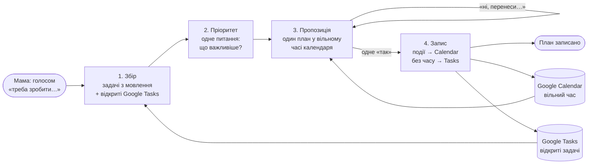
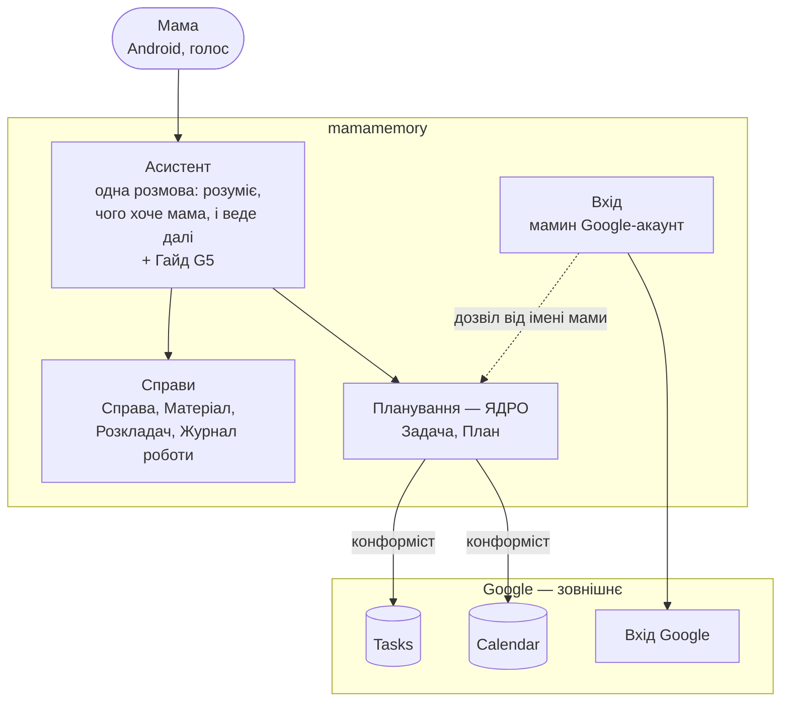

# Карта предметної області — mamamemory (M1)

Статус: M1 затверджено власником 2026-10-24 («Так, я затверджую М1»). Джерело всього нижче — `.engine/goals.md` (версія 1) і
матриця `.engine/architecture/traceability.md`. Технологій тут немає: їх вирішує M2.

## Бачення (з «Ядра»)
Мамин помічник у телефоні, з яким вона говорить голосом. Насамперед він допомагає їй спланувати
тиждень: збирає її задачі, питає, що важливіше, і сам розставляє їх у її Google Calendar і Google
Tasks. Так на планування йде година, а не день (G1, ядро). Крім того, він пам'ятає за неї справи
(пацієнтів, город) з того, що вона йому дала (G2, G3), і те, над чим вона працює саме зараз (G4).

## Механізми ядра — Планування (G1)

Розмова планування — один цикл із чотирьох кроків. Мама «дуже переключається» (розділ «Для кого
і навіщо»), тож може перервати цикл будь-коли й повернутися. Між кроками зберігається лише те, що сказала мама:
задачі, їхній порядок, її межі часу, її правки. Розстановку в часі (крок 3) не зберігаємо: її
щоразу рахуємо наново за теперішнім календарем — коли план показується знову і безпосередньо перед
записом (крок 4). Так мама ніколи не підтверджує план, складений за старим календарем.

| Крок | Що на вході | Що робить | Що на виході |
|---|---|---|---|
| 1. Збір | мамине мовлення (текстом після розпізнавання, C4); відкриті задачі з її Google Tasks | розбирає мовлення на задачі: назва, чи потрібен час, тривалість чи дата, якщо мама їх назвала; додає до списку відкриті задачі з Tasks | список задач-кандидатів |
| 2. Пріоритет | список кандидатів | короткі питання по одному: спершу — показує список і питає, що важливіше; далі — тривалість задач із часом, де мама її не назвала; далі — коли мама взагалі може робити задачі (години доби, дні), щоб план не ставив задачі на ніч; з другого планування останнє питання стає «як минулого разу?»; першого числа за замовчуванням немає — жоден рядок цілей його не називає | впорядкований список (задачі, яких мама не назвала, ідуть після названих у порядку збору); мамині межі часу |
| 3. Пропозиція | впорядкований список; мамині межі часу; зайнятий і вільний час її Google Calendar на горизонт планування (той, що назве мама, а без того — тиждень, як в ознаці G1) | за теперішнім календарем ставить задачі з часом у вільні місця в маминих межах, важливіші раніше; задачі без часу лишає без часу; показує один план; на мамину правку голосом складає план наново | план, показаний мамі (не зберігається — рахується наново): задачі на час; задачі без часу; окремо — «не вмістилось» (показано в плані, лишаються без часу в Tasks) |
| 4. Запис | збережені входи плану і одне мамине «так» | ще раз рахує розстановку за теперішнім календарем; якщо вона відрізняється від показаної мамі, показує новий план і чекає нового «так»; інакше створює події в Google Calendar; нові задачі без часу — у Google Tasks; задачу, яку крок 1 узяв із Tasks і план поставив на час, закриває в Tasks (вона тепер подія), щоб на наступному плануванні вона не повторилась; позначає, що вже записано, щоб повторне «так» нічого не подвоїло (ціна — одна позначка на задачу; голос, перемикання й повторні запити роблять повтор правдоподібним) | події й задачі в її Google без дублів; план закрито |

«Один план і одне "так"», а не підтвердження на кожну подію, — рішення архітектора як найменший обмін
(примітка guardian до G1), не вимога рядка. Джерело задач (мовлення плюс Google Tasks) —
читання архітектора, PROVISIONAL (матриця, G1).

Правила ядра: система нічого не пише в календар чи задачі мами без її «так» на план; одна задача живе в одному місці — або подією в Calendar, або задачею в Tasks.

**Куди йдуть дані.** Крок 4 виносить назви задач (а в них можуть бути дані пацієнтів, «передзвонити
Мюллер щодо аналізів») у мамині Google Calendar і Google Tasks — сервіси її звичайного Gmail-акаунта
(`docs/infra.md`). Чи покриває їх договір власника з Google і чи лежать вони в ЄС (C1), не
перевірено: premise P-CAL у `.engine/premises/premise-log.md`. Якщо вона впаде, це C1 проти C2 —
питання власникові, не рішення архітектора. Власник прийняв ризик письмово: docs/adr/0002-task-titles-in-mama-calendar.md. У Calendar і Tasks
іде лише назва задачі, як її сказала мама, з часом; матеріали справ туди не йдуть.

## Підтримка — Справи (G2, G3)

Справа — пацієнт або проєкт. У неї є назва, а всередині — матеріали.

- **Внесення (G3).** Матеріал — це нотатка (голос, перетворений на текст) або документ (фото чи файл).
  Зміст фото чи файлу стає доступним для читання (як саме — вирішує M2). Розкладач за змістом і
  словами мами визначає справу. Якщо такої справи немає, він питає маму і після її згоди створює
  справу. Якщо дві справи однаково схожі, кладе в найімовірнішу і текстом (уголос — лише на прохання, C4) каже, в яку, —
  мама може сказати «перекласти». Перекласти матеріал можна, сказавши
  це асистентові (G3); окремих екранів із папками немає.
- **Пригадування (G2).** На питання про справу асистент визначає справу і відповідає з її матеріалів.

- **Журнал роботи (G4).** Простий список: кожне «зараз працюю над …» — текстовий запис із часом;
  прив'язка до справи — необов'язкова, якщо справа очевидна з фрази, не окремий механізм. Попередні записи не стираються, тож «що я робила з договором?» працює і після перемикання.
  Запис без справи — законний стан. Пригадування справи (G2) читає й записи роботи цієї справи — «що зробили».

## Підтримка — Гайд (G5)

- **Гайд.** Короткий текст про те, що вміє асистент. Він сам каже його на першому вході і на «що ти вмієш?».

## Межі (bounded contexts) і зв'язки

Bounded context — частина предметної області зі своїми словами й своїм життям.

- **Асистент → Планування, Справи:** асистент розуміє, чого хоче мама (спланувати, спитати про
  справу, внести, «над чим працюю», «що ти вмієш»), і передає це відповідній частині.
- **Планування → Google Calendar, Tasks:** відношення «конформіст» (playbook, software-architecture
  §4.7): беремо моделі подій і задач Google як є, без власного перекладу, бо вони чисті й це її
  власний календар.
- **Вхід:** мамин Google-акаунт (C3) дає і вхід, і дозвіл діяти в її Calendar і Tasks. Усі дані
  в сховищі лежать під ідентифікатором цього акаунта (рішення власника, ADR-0001).

Асистент — тонкий маршрутизатор: власних правил і стану не має (стан планування — у Чернетці плану,
стан справ — у Справах); нова можливість не оселяється в Асистенті.

Глибина за статусом цілі: Планування — ядро, розписане вище покроково. Справи, Журнал і Гайд —
підтримка. «Підтримка» тут не означає «тонше» чи «пізніше»: власник сказав «треба зробити всі три»
(журнал, 18:23Z), а Розкладач і відповіді з матеріалів справи — найскладніший механізм системи і перший кандидат на
PoC у M2 (визначити справу за фото і відповісти з її матеріалів). Вхід і Google — загальні частини, їх беремо готовими.

## Єдина мова (ubiquitous language)
| Слово | Значення |
|---|---|
| Мама | єдина користувачка; її Google-акаунт |
| Задача | те, що мама має зробити; **з часом** (стає подією в Calendar) або **без часу** (живе в Tasks) |
| План | запропонований розклад задач на горизонт; чернетка до маминого «так», після нього — записаний |
| Справа | пацієнт або проєкт; має назву й матеріали |
| Матеріал | нотатка або документ, що належить одній справі |
| Нотатка | коротке мамине мовлення, збережене текстом |
| Документ | фото або файл разом із текстом, дістаним із нього |
| Розкладач | частина, що визначає справу матеріалу |
| Запис роботи | «зараз працюю над …» з часом, можливо з прив'язкою до справи |
| Гайд | короткий текст «що я вмію і як зі мною працювати» |

## Таблиця елементів
| Елемент | Що робить | Джерело |
|---|---|---|
| Асистент | одна розмова з мамою: розуміє, чого вона хоче, веде до потрібної частини | G1, G2, G3, G4, G5, C4 |
| Голосовий ввід | перетворює мамине мовлення на текст для питань і нотаток | C4 |
| Озвучення на прохання | читає відповідь уголос, лише коли мама попросить | C4 |
| Збір задач | дістає задачі з мовлення й бере відкриті задачі з Google Tasks | G1, C2 |
| Пріоритет | короткими питаннями по одному дізнається в мами, що важливіше, тривалість, де її бракує, і коли вона може робити задачі | G1 |
| Пропозиція плану | ставить задачі у вільний час календаря, показує один план, переробляє на правку | G1, C2 |
| Запис плану | після «так» пише події в Calendar і задачі в Tasks без подвоєнь; закриває в Tasks задачу, що стала подією | G1, C2 |
| Чернетка плану | зберігає мамині входи плану (задачі, порядок, межі часу, правки), коли вона перервалась; розстановку не зберігає | G1 |
| Справа | папка однієї справи (пацієнт або проєкт) | G2, G3 |
| Матеріал | нотатка або документ у справі | G3 |
| Текст із документа | робить зміст фото чи файлу доступним для читання | G3, G2 |
| Розкладач | визначає справу матеріалу; питає маму перед новою справою; при двох однаково схожих — кладе в найімовірнішу й каже, в яку; перекладає на прохання | G3 |
| Пригадування справи | відповідає на питання про справу з її матеріалів і записів роботи | G2 |
| Журнал роботи | зберігає записи «працюю над …» з часом і відповідає «що я робила?» | G4 |
| Гайд | короткий текст про вміння асистента; на першому вході й на прохання | G5 |
| Вхід | вхід мамина Google-акаунта з дозволами на Calendar і Tasks; лише її акаунт | C3, C7, C1 |
| Дані під акаунтом | усе в сховищі лежить під ідентифікатором акаунта, що ввійшов | docs/adr/0001-data-under-signed-in-account.md |
| Застосунок, що встановлюється | веб-застосунок із камерою й мікрофоном, без магазинів | C5, C4, G3 |

## Пропозиції
Елементи без джерела; у дизайн — лише рішенням власника.
- Google Drive як сховище матеріалів (Q4: власник не вирішив). Ціна: дозвіл на Drive в мами й
  залежність від її Drive; користь — мама бачить файли в звичному місці.
- Окремий векторний пошук по справах («легенький раг», Q3). Ціна: ще одна частина, яку треба
  тримати й оплачувати; потрібність вирішить M2 за обсягом справ.

## Звірка з цілями
- служить: G1, G2, G3, G4, G5, D1
- вибір між варіантами розв'язав: принципи не розрізняють варіанти M1; «Дані під акаунтом» — рішення
  власника (ADR-0001); решта виборів — читання архітектора, позначені PROVISIONAL у матриці; P1 діє в M2
- не-цілі й обмеження: N1, N2, N3, N4, N5, N7 — не зачеплені, жодного елемента за ними; N6 — не
  закрито через «Дані під акаунтом» (ADR-0001), багатокористувацького не будуємо; C1 — кожна частина,
  що бачить дані, перевіряється в M2, зокрема мамині Calendar і Tasks (P-CAL); C2, C3, C4, C5, C7 — у таблиці елементів; C6 — у M2
